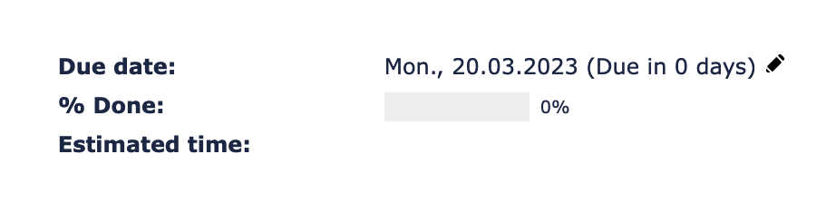
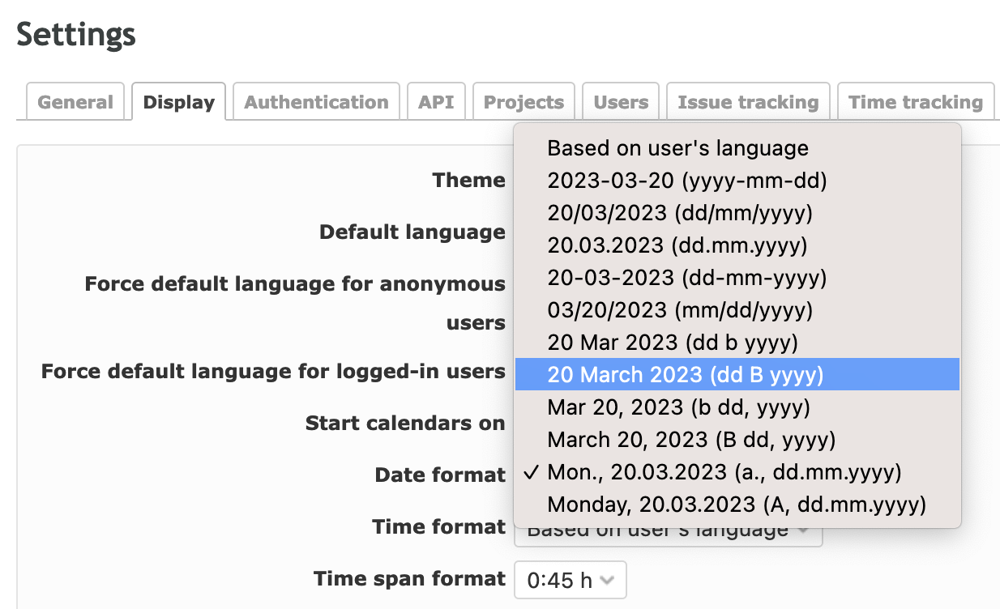

# Redmine Add Date Formats with Week Days

A small [Redmine](https://www.redmine.org/) plugin that adds date formats **with week days** to the date format setting.



## Introduction

Redmine offers almost everything we need out of the box. We only had to extend it a little for our internal needs, and this plugin was the result.

## Features

The plugin adds two extra options to **Administration → Settings → Display → Date format**:

| Format          | Example (German)       | Example (English)    |
|-----------------|------------------------|----------------------|
| `%a., %d.%m.%Y` | Do., 22.10.2026        | Thu., 22.10.2026     |
| `%A, %d.%m.%Y`  | Donnerstag, 22.10.2026 | Thursday, 22.10.2026 |

Week days are localized automatically using the language of the current user. All of Redmine's built-in date formats remain available.

## Installation

1. Clone the plugin into the `plugins` directory of your Redmine installation. The directory name must be `add_date_formats_with_week_days`, as it has to match the plugin ID:

   ```bash
   cd /path/to/redmine/plugins
   git clone https://github.com/ablida/add_date_formats_with_week_days.git
   ```

   Alternatively, download the repository as a ZIP and extract it to `plugins/add_date_formats_with_week_days`.

2. Restart Redmine.

No database migrations are required. More information on installing Redmine plugins: [Redmine Plugins](https://www.redmine.org/projects/redmine/wiki/Plugins).

## Upgrading from `add_date_formats_with_day_names`

Up to version 0.0.1 the plugin was called `add_date_formats_with_day_names`. To upgrade:

1. Remove the old directory `plugins/add_date_formats_with_day_names`.
2. Install the new version as described above.
3. Restart Redmine.

Your selected date format is kept, since Redmine stores the format itself and not the plugin name.

## Configuration

1. Click **Administration** in the top menu.
2. Open **Settings** and switch to the **Display** tab.
3. Pick one of the new entries in the **Date format** dropdown and save.



## Usage

Once a new format is selected and saved, dates throughout Redmine are shown with week days after the next page reload.

## Uninstallation

Remove the `plugins/add_date_formats_with_week_days` directory and restart Redmine. If one of the plugin's formats was selected, choose a different date format in the settings first.

## License

This plugin is licensed under the [GNU General Public License v2.0](https://www.gnu.org/licenses/old-licenses/gpl-2.0.html), unless otherwise stated.

## About

Copyright (c) 2021–2026 ablida
